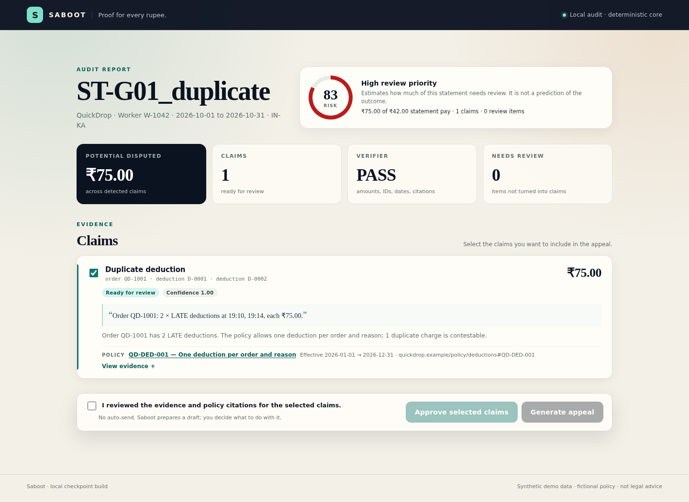

# Saboot

**Proof for every rupee.** Saboot is an evidence-backed payout auditor for gig workers. This is the **final delivery build**: the deterministic engine, ingestion, five claim detectors, evidence bundles, policy citations, verifier, CLI, local web UI, human approval, template-first appeal, PDF export, 20 golden fixtures, Playwright E2E, mobile check, and a 2:31 narrated demo.

> **Status:** final local checkpoint build. The 2:31 narrated demo is at `proof/demo/saboot-demo.mp4`. No OCR, Hindi, deployment, or case tracker. The platform **QuickDrop** and its policy pack are fictional; all statements are synthetic. This is a request-for-review workflow, not legal advice.



---

## What it does

A worker uploads a payout statement. Saboot:

1. Ingests a CSV bundle or a line-oriented text PDF.
2. Reconciles expected pay against recorded earnings, order by order.
3. Detects five contestable claim types:
   - duplicate deduction
   - over-cap deduction
   - restaurant-delay penalty
   - incentive shortfall
   - missing earning
4. Builds an evidence bundle for each claim: order IDs, deduction IDs, timestamps, arithmetic, source rows, a source quote, and an applicable policy clause with a source URL and effective dates.
5. Assigns a confidence score and a `ready` / `needs_review` status.
6. Runs a verifier that rejects unsupported amounts, unknown IDs, fabricated dates, inapplicable citations, legal advice, outcome promises, and real platform brand names.
7. Shows the report in a local web UI with a review-priority score, claim cards, evidence, and policy citations.
8. Requires an explicit human approval before drafting an appeal.
9. Generates a template-first English appeal (optional LLM rewrite behind a provider interface), verifies it, and exports an appeal + evidence PDF.

The engine is deterministic so the money math and evidence are auditable. The optional LLM only rewrites language; it cannot add amounts or citations.

---

## Quick start

Requirements: Python 3.11+ (standard library only). For text-PDF ingestion, install `poppler-utils` (`pdftotext`). CSV works without it.

```bash
# From the repository root
PYTHONPATH=src python3 -m saboot audit \
  --bundle data/fixtures/golden/G01_duplicate/statement \
  --policy data/policy/quickdrop_policy.json \
  --out proof/G01_duplicate \
  --format both
```

Or use the wrapper:

```bash
./bin/saboot audit --bundle data/fixtures/golden/G01_duplicate/statement
```

Outputs:

```text
proof/G01_duplicate/audit.json
proof/G01_duplicate/audit.md
```

---

## CLI

```text
python3 -m saboot audit --bundle <dir-or-zip> [--policy <json>] [--out <dir>] [--format both|json|markdown] [--strict]
python3 -m saboot audit --pdf <text.pdf>    [--policy <json>] [--out <dir>] [--format both|json|markdown] [--strict]
```

- `--bundle` accepts a directory or a zip containing the five CSV files.
- `--pdf` accepts a **line-oriented text PDF** in the QuickDrop export format (not a scan).
- `--strict` exits 1 if verification fails or any claim/review item needs human review.
- `--format` defaults to `both` (`audit.json` + `audit.md`).

---

## Local web UI

```bash
# One-time browser install for the E2E proof
npm install

# Start the local UI
PYTHONPATH=src python3 -m saboot.webapp --port 8765
# open http://127.0.0.1:8765
```

Primary flow:

1. Upload a text PDF or a CSV bundle `.zip`.
2. See the audit report: review-priority score, total disputed, claim cards, source quote, policy citation, confidence, and `needs_review` state.
3. Open “View evidence” to inspect the arithmetic, source rows, and verifier result.
4. Check “I reviewed the evidence…” and approve selected claims.
5. Generate the template appeal; inspect the verifier badge and citations.
6. Download the appeal + evidence PDF.

The template path works with **no API key**. Optional LLM rewriting is available behind `saboot.llm.DraftProvider`; enable it only with `SABOOT_LLM_PROVIDER=gemini` and `GEMINI_API_KEY`. Any provider failure falls back to the template.

The E2E uses the installed **Google Chrome** channel (Playwright 1.65). `node_modules` is not committed; run `npm install` once.

### E2E proof

```bash
bash scripts/run_e2e.sh
```

This starts the local server, uploads `proof/G01_duplicate/statement.pdf`, asserts the ₹75 duplicate claim, opens the evidence, asserts the source quote and `QD-DED-001`, approves, generates the appeal, asserts `Verifier PASS`, downloads the PDF, and writes screenshots/video/logs to `proof/ui/`.

### Final narrated demo

- Video: `proof/demo/saboot-demo.mp4` — **2:31**, 1920×1080, H.264/AAC, TTS narration, burned-in captions; audio mean −16.7 dB, peak −1.3 dB, no clipping.
- Thumbnail: `proof/demo/thumbnail.png` — 1200×800.
- Voiceover script: `proof/demo/voiceover.txt`.
- Shot list: `docs/demo-shot-list.md`.
- Rebuild commands: `proof/demo/README.md`.

The demo uses the **template path with no API key**. It shows upload → ₹75 duplicate claim → source quote → policy citation → human approval → appeal → verifier PASS → exported PDF.

---

## Screenshots

| Screen | Desktop | Mobile |
|---|---|---|
| Upload | `proof/ui/01-upload.png` | `proof/mobile/01-upload-390x844.png` |
| Report | `proof/ui/03-report.png` | `proof/mobile/02-report-390x844.png` |
| Evidence | `proof/ui/04-evidence.png` | — |
| Approved | `proof/ui/05-approved.png` | — |
| Appeal | `proof/ui/06-appeal.png` | — |
| Exported PDF | `proof/demo/appeal-page.png` | — |

The 390×844 check is `bash scripts/run_mobile_check.sh`; it asserts zero horizontal overflow on both screens.

---

## AI tools and legal disclaimer

- **Runtime AI:** none by default. The audit engine is deterministic. An optional Gemini 2.5 Flash provider sits behind `saboot.llm.DraftProvider`; it is disabled unless `SABOOT_LLM_PROVIDER=gemini` and `GEMINI_API_KEY` are set. The demo uses the template path with no API key.
- **Development AI:** built with AI coding assistance (OpenCode / DeepSeek V4.1 Flash) under human-supervisor checkpoints. All code, tests, and demo capture were executed and verified locally.
- **Voiceover:** ElevenLabs neural TTS (George, eleven_multilingual_v2). Captions were generated from ElevenLabs forced word alignment.
- **App runtime:** no paid APIs. The demo voiceover was generated with ElevenLabs. No real user data; QuickDrop is fictional.
- **Legal:** this is a request for review, not legal advice. Saboot does not auto-send, does not name real platforms, and does not promise an outcome.

See [`docs/architecture.md`](docs/architecture.md), [`docs/data-card.md`](docs/data-card.md), and [`TESTING.md`](TESTING.md).

---

## Input format

### CSV bundle

```text
statement/
  meta.csv
  orders.csv
  earnings.csv
  deductions.csv
  incentives.csv
```

`meta.csv`:

```text
statement_id,platform,worker_id,period_start,period_end,currency,jurisdiction
```

`orders.csv`:

```text
order_id,accepted_at,picked_up_at,delivered_at,promised_delivery_at,restaurant_prep_minutes,distance_km,status,base_pay,surge_pay,tip,total_pay
```

`earnings.csv`:

```text
earning_id,order_id,earning_type,amount,description
```

`deductions.csv`:

```text
deduction_id,order_id,deduction_code,description,amount,applied_at
```

`incentives.csv`:

```text
incentive_id,name,target_orders,target_amount,achieved_orders,amount_promised,amount_paid,qualifying_order_ids
```

Money may include `₹`, `Rs.`, `INR`, and commas. Timestamps are ISO 8601; naive timestamps are treated as Asia/Kolkata.

### Text PDF

A line-oriented text export, one record per line:

```text
meta|statement_id=ST-...|platform=QuickDrop|worker_id=W-...|period_start=...|period_end=...|currency=INR|jurisdiction=IN-KA
order|order_id=QD-1001|accepted_at=...|picked_up_at=...|delivered_at=...|promised_delivery_at=...|restaurant_prep_minutes=12|distance_km=3.0|status=delivered|base_pay=42.00|surge_pay=0.00|tip=0.00|total_pay=42.00
earning|earning_id=E-0001|order_id=QD-1001|earning_type=base|amount=42.00|description=Base pay
deduction|deduction_id=D-0001|order_id=QD-1001|deduction_code=LATE|description=Late delivery penalty|amount=75.00|applied_at=...
incentive|incentive_id=INC-0001|name=5-order streak|target_orders=5|target_amount=0|achieved_orders=5|amount_promised=500|amount_paid=450|qualifying_order_ids=
```

`pdftotext` extracts the records; the parser groups them by `record_type`. Scanned/image PDFs are out of scope for this checkpoint.

---

## Repo layout

```text
saboot/
  bin/saboot                 # CLI wrapper
  README.md
  TESTING.md
  src/saboot/
    schema.py                # canonical model + money/datetime parsing
    ingestion/               # CSV bundle, zip, text PDF, shared segmentation
    policy.py                # policy book, clause lookup, cap rules
    reconciliation.py        # order-level expected vs actual pay
    detectors.py             # duplicate, over-cap, delay, incentive, missing
    claims.py                # Claim / ReviewItem models
    verifier.py              # evidence and language gate
    render.py                # JSON + Markdown reports
    audit.py                 # orchestration
    cli.py                   # argparse CLI
    appeal.py                # template-first appeal + appeal verifier
    llm.py                   # optional DraftProvider interface (template default)
    pdf_export.py            # dependency-free appeal/evidence PDF
    webapp/                  # local HTTP server + single-page UI + risk score
  data/policy/               # fictional QuickDrop policy pack
  data/fixtures/golden/      # 20 hand-authored fixtures + expected.json
  data/fixtures/edge/        # needs-review edge case
  proof/                     # CLI runs + proof/ui + proof/mobile + proof/demo
  eval/report.md             # 20-fixture evaluation report
  eval/results.json          # machine-readable results
  tests/                     # 57 stdlib unittest tests
  tests/ui/                  # Playwright E2E + 390×844 mobile check
  scripts/run_e2e.sh         # starts server, runs E2E, captures proof/ui
  scripts/run_mobile_check.sh # 390×844 upload/report check -> proof/mobile
  scripts/build_demo_video.sh # TTS + captions + mux -> proof/demo/saboot-demo.mp4
  tools/build_demo_audio_eleven.py # ElevenLabs TTS + forced alignment + captions
  tools/record_demo.js       # Playwright 1920×1080 demo capture
  tools/make_fixtures.py     # materializes the hand-authored fixtures
  tools/make_pdf.py          # builds the line-oriented text PDF
  tools/eval_golden.py       # evaluates all 20 fixtures
```

---

## Tests

```bash
make test        # PYTHONPATH=src python3 -m unittest discover -s tests -v
make eval        # runs the 20 golden fixtures and writes eval/report.md
make e2e         # runs the Playwright UI proof and writes proof/ui/
make mobile      # runs the 390×844 mobile check and writes proof/mobile/
```

Latest results:

- **57 tests passed**, 0 failures.
- **20/20 fixtures passed**.
- **17 expected claims, 17 matched, 0 false positives, 0 false negatives**.
- **Precision 1.00, recall 1.00, F1 1.00** on this hand-authored set.
- **Verifier pass 20/20**.
- **Playwright E2E 1/1 passed**: upload PDF → ₹75 duplicate claim → evidence → approve → appeal → verifier PASS → PDF.
- **Mobile 390×844 check 1/1 passed**, zero horizontal overflow on upload and report.
- **Final demo**: 2:31, 1080p, TTS narration + burned-in captions.

This is a small regression baseline, not a 200-case benchmark. See [`eval/report.md`](eval/report.md) and [`TESTING.md`](TESTING.md).

---

## Detector logic

| Claim type | Detection | Allocation |
|---|---|---|
| Duplicate deduction | Same order + code appears more than once; keep the earliest, claim the rest | Extras consumed first |
| Over-cap deduction | Deduction above the policy cap (`max` of a fixed floor and a percentage of order pay) | Claims only the excess; leaves the legitimate cap portion |
| Restaurant-delay penalty | `LATE` penalty where restaurant prep > 20 minutes | Claims the remaining penalty after duplicate/over-cap allocation |
| Incentive shortfall | Target met but amount paid < promised | Claims the difference |
| Missing earning | Delivered order with no earning entry | Claims expected order pay |

The per-deduction allocation ledger prevents double-claiming the same rupee. G06 (duplicate + over-cap) and G07 (delay + over-cap) explicitly test this.

**MVP note:** incentives use an **order target** (`target_orders`). The schema reserves `target_amount` for a later monetary-target milestone; it is not used by the detector yet.

---

## Verifier

Every claim must survive these checks before it is shown as `ready`:

- amount positive; components sum to the claim amount; claim ≤ evidence support limit
- every order/deduction/earning/incentive ID exists in the statement
- every evidence timestamp exists in the statement
- policy clause exists, applies to the claim type, matches the jurisdiction, and is effective on the event date
- policy clause has an `http(s)` source URL
- no legal advice, no outcome promise, no real platform brand name
- claim type-specific checks (duplicate group, cap, prep time, incentive target, delivered-order status)

A failure moves the claim to `needs_review` and records the verifier errors.

---

## Responsible AI and scope

- **No auto-send.** A human reviews every claim and approves before an appeal is drafted.
- **Evidence-bound.** Every claim has IDs, timestamps, arithmetic, a source quote, and a policy citation.
- **No legal advice.** The output is a request for review.
- **Synthetic by default.** QuickDrop is fictional; the policy pack is synthetic and labeled; all fixtures are synthetic.
- **No real brands in claims.** The verifier rejects real platform names.
- **Template-first.** The default appeal path is deterministic and needs no API key. The optional LLM rewrite is verifier-gated and falls back to the template.
- **Local-only.** The server binds to `127.0.0.1`; no external calls unless the optional Gemini provider is enabled.

## Known limitations

- No OCR/scanned-image ingestion; CSV and line-oriented text PDF only.
- No Hindi output yet (English only).
- No deployment or case tracker. The demo is local and the video is the judging artifact.
- The 20-fixture evaluation is a regression baseline, not a 200-case benchmark.
- The optional Gemini provider path is implemented behind an interface but is not exercised by the E2E; the template path is the safe path.
- The UI E2E runs on desktop Chrome; a separate 390×844 mobile screenshot check covers upload/report but not the full approval flow.
- Real platform statement formats still need adapters.

See [`docs/architecture.md`](docs/architecture.md) for the as-built design and [`docs/demo-shot-list.md`](docs/demo-shot-list.md) for the final 2:30 capture plan.

---

## License

MIT. See [`LICENSE`](LICENSE).
