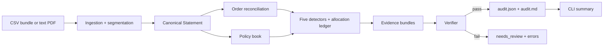

# Saboot — architecture as built (final delivery)

**Scope:** deterministic audit engine + local web UI + template-first appeal + PDF export + final narrated demo. No OCR, Hindi, deployment, case tracker, or 200-case benchmark.

## 0. Build layers

| Layer | Status | Modules |
|---|---|---|
| Deterministic core | M0–M2 | `schema`, `ingestion`, `policy`, `reconciliation`, `detectors`, `verifier`, `render`, `audit` |
| Appeal + PDF | M3 | `appeal`, `pdf_export`, `llm` provider interface |
| Local UI | M4 | `webapp/server`, `webapp/risk`, `webapp/static/*` |
| E2E + mobile proof | M4 | `tests/ui/saboot.spec.js`, `tests/ui/mobile.spec.js`, `scripts/run_e2e.sh`, `scripts/run_mobile_check.sh` |
| Final demo | Delivery | `tools/build_demo_audio_eleven.py`, `tools/record_demo.js`, `scripts/build_demo_video.sh` |

## 1. Pipeline

The engine is intentionally deterministic. The verifier is a hard gate: a claim cannot be `ready` unless every amount, ID, timestamp, and citation is supported by the statement and policy.

## 2. Components

| Component | Module | Responsibility |
|---|---|---|
| Parsing | `schema.py` | Decimal money, ISO datetimes, canonical dataclasses |
| CSV ingestion | `ingestion/csv_ingest.py` | Directory/zip bundle, headers, zip-slip protection |
| PDF ingestion | `ingestion/pdf_ingest.py` | `pdftotext` extraction of line-oriented text exports |
| Segmentation | `ingestion/segment.py` | Validation, foreign keys, computed prep time, source-row map |
| Policy | `policy.py` | Clause book, applicability filters, cap-rule evaluation |
| Reconciliation | `reconciliation.py` | Expected vs actual pay per order |
| Detectors | `detectors.py` | Five claim types + allocation ledger + review items |
| Claims | `claims.py` | Claim/review models and serialization |
| Verifier | `verifier.py` | Evidence, citation, arithmetic, language checks |
| Rendering | `render.py` | JSON and Markdown |
| Orchestration | `audit.py` | Runs detectors, verifier, reconciliation, summary |
| CLI | `cli.py` | `audit` command, formats, strict mode |

## 3. Data model

- `Statement`: meta + orders + earnings + deductions + incentives + source map.
- `Order`: expected pay, timeline, prep minutes, status.
- `Deduction`: order, code, amount, applied-at.
- `Earning`: order, type, amount.
- `Incentive`: target, achieved, promised, paid.
- `Claim`: type, amount, status, confidence, IDs, components, support limit, clause, evidence.
- `ReviewItem`: type, description, IDs, confidence, evidence.

All money is `Decimal` internally; JSON renders floats plus display strings.

## 4. Detector order and the allocation ledger

Order matters because one deduction can be partly duplicate, partly over-cap, and partly protected by the restaurant-delay clause.

1. **Duplicate** — group by `(order_id, code)`, keep the earliest, claim the rest; consume the extras.
2. **Over-cap** — on the remaining amount, evaluate the clause cap, claim only the excess, leave the cap portion.
3. **Restaurant delay** — on the remaining `LATE` amount, if prep > 20, claim the rest.
4. **Incentive** — target met, promised > paid, claim the difference.
5. **Missing earning** — delivered order, zero earnings, claim expected pay.

The ledger is exposed as `allocation_remaining` in `audit.json` so a reviewer can see exactly what was consumed. G06 and G07 are the explicit allocation tests.

## 5. Policy model

The fictional QuickDrop policy has seven clauses:

| Clause | Purpose |
|---|---|
| `QD-DED-001` | One deduction per order/reason |
| `QD-DED-002` | Late penalty cap = max(₹100, 25% of order pay) |
| `QD-DED-003` | Cancellation cap = max(₹50, 10% of order pay) |
| `QD-DED-004` | No late penalty when restaurant prep > 20 min |
| `QD-INC-001` | Pay the full incentive when the target is met |
| `QD-EARN-001` | Every delivered order needs an earning entry |
| `QD-REV-001` | Unclear deductions need human review |

Every clause carries a source URL and effective dates. The verifier rejects a clause that is not effective on the event date or does not apply to the claim type.

## 6. Verifier checks

- amount > 0; component sum = amount; amount ≤ support limit
- order/deduction/earning/incentive IDs exist
- evidence timestamps exist in the statement
- clause exists, applies to claim type, matches jurisdiction, is effective
- clause has an http(s) source URL
- no legal advice, no outcome promise, no real platform brand
- type-specific checks: duplicate group size, cap arithmetic, prep time, incentive target, delivered status

A failed claim becomes `needs_review` with errors attached; it is not silently dropped.

## 7. Appeal generation (M3)

- `appeal.py` builds a template from the approved claims only. It refuses `needs_review` claims.
- The body includes: claim type, amount, order/deduction IDs, source quote, policy clause and source URL, why, requested action, total, and a “request for review, not legal advice” footer.
- `llm.py` exposes a tiny `DraftProvider` interface. `TemplateProvider` is the default and works with no API key. `GeminiProvider` is optional, enabled only by `SABOOT_LLM_PROVIDER=gemini` + `GEMINI_API_KEY`, and any failure falls back to the template.
- An LLM rewrite is accepted only if `verify_appeal_text` passes: all amounts are supported by claim evidence, all citations exist, no legal advice, no outcome promise, no real brand.
- `pdf_export.py` writes a dependency-free PDF with the appeal, evidence appendix, policy citations, verifier status, and human approval record.

## 8. Local web UI (M4)

```mermaid
flowchart LR
  U[Browser upload] -->|base64 PDF/ZIP| API[POST /api/audit]
  API --> E[Same Python engine]
  E --> R[Report payload + risk score]
  R --> UI[Single-page report]
  UI -->|select + review checkbox| A[POST /api/approve]
  A --> G[POST /api/appeal]
  G --> V[Appeal verifier]
  V --> P[POST /api/export -> PDF]
```

- **Server:** Python `http.server` (`ThreadingHTTPServer`), no third-party web framework.
- **Static UI:** one `index.html`, one `styles.css`, one `app.js`; no build step, no CDN, no external fonts.
- **State:** in-memory `CaseStore` keyed by `audit_id`; single-user local app.
- **Risk score:** presentation-layer review priority from disputed/expected pay + claim count + review items. Not a prediction of outcome.
- **Upload:** base64 JSON; PDF or CSV-bundle `.zip`; 10 MB limit; temp file is deleted after parsing.
- **Approval:** explicit human checkbox + button; `needs_review` claims cannot be approved; no auto-send.
- **PDF:** generated server-side and returned as an attachment.
- **Privacy:** server binds to `127.0.0.1` by default; no external calls unless the optional Gemini provider is enabled.

## 9. Test and proof layer

- 57 stdlib `unittest` tests: schema, ingestion, detectors, verifier, CLI, golden fixtures, appeal, PDF, web API, risk.
- 20 hand-authored golden fixtures, 17 expected claims, 0 FP/FN, verifier 20/20.
- Playwright E2E (`tests/ui/saboot.spec.js`) uploads `proof/G01_duplicate/statement.pdf`, asserts the ₹75 duplicate claim, opens the evidence, asserts the source quote and `QD-DED-001`, approves, generates the appeal, asserts `Verifier PASS`, downloads the PDF, and captures screenshots/video/console logs in `proof/ui/`.
- `scripts/run_e2e.sh` starts the local server, runs Playwright, copies the video, and writes `proof/ui/e2e.log` + `server.log`.
- `tests/ui/mobile.spec.js` checks 390×844 upload/report and zero horizontal overflow; `scripts/run_mobile_check.sh` captures `proof/mobile/`.
- Final demo: `tools/build_demo_audio_eleven.py` (ElevenLabs TTS), `tools/record_demo.js` (Playwright capture), `scripts/build_demo_video.sh` (ffmpeg captions + mux) → `proof/demo/saboot-demo.mp4` (2:31).

## 10. Boundaries and next layer

**In scope now:** CSV + text PDF, five detectors, evidence, policy citations, confidence, needs-review, CLI, local UI, human approval, template appeal, optional LLM interface, PDF export, E2E proof, mobile check, final narrated demo.

**Out of scope now:** OCR/scanned images, Hindi, deployment, case tracker, 200-case benchmark, productivity/pricing features.

The deterministic core remains the source of truth; the optional LLM only drafts language and is verifier-gated.
